# 🛡️ Dell ControlVault 2 (BCM5880) Linux Fingerprint Driver
## Complete Reverse Engineering & Implementation Journey

> [!abstract] **ملخص الرحلة (Executive Summary)**
> تحويل شريحة بصمة الإصبع **Dell ControlVault 2 (Broadcom BCM5880 / USB 0a5c:5834)** من جهاز غير مدعوم تماماً على لينكس (يعمل على ويندوز فقط) إلى جهاز مدعوم ويعمل بكفاءة 100%، عبر الهندسة العكسية وتطبيق 7 ترقيعات ثنائية (Binary Byte-Patches) على درايفر برودكوم الرسمي، وتجاوز قيود نظام التشغيل وتجهيز حزمة تثبيت أوفلاين مستقلة مع دمج منظومة المصادقة الثلاثية (بصمة إصبع ➔ بصمة وجه Howdy ➔ كلمة المرور).

---

## 🗺️ مخطط سير العمل الكامل (Execution Roadmap)

```mermaid
flowchart TD
    subgraph Phase1["المرحلة 1: تحليل المشكلة والعتاد"]
        A["الهدف: تشغيل بصمة ديل BCM5880 (0a5c:5834) على كالي/لينكس"] --> B["فحص ملف الويندوز: Dell-ControlVault2...EXE"]
        B --> C["هندسة عكسية لبروتوكول الويندوز (Endpoints 0x01/0x81 وترويسة 44-byte)"]
    end

    subgraph Phase2["المرحلة 2: استراتيجية الهندسة العكسية"]
        C --> D["اكتشاف: ديل تصدر درايفر رسمي لـ CV3 فقط (0a5c:5842)"]
        D --> E["الحل العبقري: ترقيع باينري درايفر CV3 ليتوافق مع CV2"]
        E --> F["تحميل درايفر Broadcom الرسمي واستخراج ملفات Citadel Firmware"]
    end

    subgraph Phase3["المرحلة 3: الترقيعات الثنائية الـ 7 (Binary Patching)"]
        F --> G1["Patch 1 & 2: تغيير الـ PID إلى 0x5834 وتجاوز فحص USB"]
        G1 --> G2["Patch 3: تجاوز خطأ الفلاش 0x1c (Chip resident ROM)"]
        G2 --> G3["Patch 4 & 5: ربط حالة 0x59 بالـ Commit وإصلاح تقرير الـ Verify"]
        G3 --> G4["Patch 6 & 7: حقن هوية ديل BroadcomWBF (حل خطأ 0x24 في المرحلة 5)"]
    end

    subgraph Phase4["المرحلة 4: حل عقبات نظام كالي/ديبيان"]
        G4 --> H1["توفير مكتبات TOD: ديبيان لا يدعم TOD تلقائياً (تثبيت حزم Deb)"]
        H1 --> H2["فك حظر الخدمة: Unmask fprintd.service وحذف رابط dev/null"]
        H2 --> H3["صلاحيات Polkit: إضافة قاعدة 50-fprintd.rules لمنع PermissionDenied"]
    end

    subgraph Phase5["المرحلة 5: الاختبار والنجاح على الجهاز"]
        H3 --> I1["تشغيل fprintd-enroll: اجتياز المراحل الخمس بنجاح تام"]
        I1 --> I2["تشغيل fprintd-verify: التحقق بنجاح من البصمة"]
    end

    subgraph Phase6["المرحلة 6: الحزمة المستقلة والتوزيع"]
        I2 --> J1["إنشاء اسكريبت التثبيت الصامت Offline install.sh"]
        J1 --> J2["بناء اسكريبت الفحص والتشخيص verify.sh"]
        J2 --> J3["تجميع الدرايفر + الفيرموير + الحزم في dell-controlvault2-linux-driver.zip"]
    end

    subgraph Phase7["المرحلة 7: تنسيق منظومة الدخول (PAM Pipeline)"]
        J3 --> K["ترتيب أسبقية الدخول في common-auth: بصمة الإصبع ➔ الوجه (Howdy) ➔ كلمة السر"]
    end
```



---

## 🔬 تفاصيل المراحل خطوة بخطوة

### 1️⃣ المرحلة الأولى: فحص العتاد وهندسة ملف الويندوز
* **العتاد المستهدف:**
  * جهاز: Dell Latitude 5591 (ينطبق على 5490, 5590, 7390, 7490, 5480, 7480, E7470... إلخ).
  * الشريحة: `Broadcom Corp. 5880` برقم تعريف `0a5c:5834`.
* **الملف الأولي المقدم:**
  `Dell-ControlVault2-Driver-and-Firmware_N23KC_WIN64_4.12.5.8_A21_03.EXE`
* **نتائج تحليل الهندسة العكسية:**
  1. استخراج ملفات التشغيل: `cvusb5880.sys` (Kernel Mode Driver) و `wbf_cvusb5880.dll` (Windows Biometric Framework).
  2. اكتشاف بروتوكول الاتصال:
     * **Endpoint `0x01`:** Bulk OUT لإرسال الأوامر.
     * **Endpoint `0x81`:** Bulk IN لاستقبال الردود وقوالب البصمة.
     * **Endpoint `0x85`:** Interrupt IN لإشارات المقاطعة والتنبيه عند لمس الحساس.
  3. اكتشاف هيكل الحزم المغلفة: ترويسة بطول 44 بايت تبدأ بـ `cvhEncapsulateCmd` تنقل الأوامر لمعالج الأمان الداخلي.
  4. اتضح أن الشريحة تعمل بسوفتوير مقيم داخلياً (Resident ROM/OTP) ولا تحتاج لفلاش فوري مع كل إقلاع.

---

### 2️⃣ المرحلة الثانية: استراتيجية "الدرايفر الهجين المُرقع"

> [!question] **لماذا لم نقم ببناء درايفر من الصفر؟**
> بناء درايفر كامل يتعامل مع معالجات التشفير الخاصة ببرودكوم (USH / Citadel) يستغرق شهوراً ويتطلب التوقيع الأمني الخاص بالمعالج.
> بدلاً من ذلك، قامت Canonical وديل بإصدار درايفر رسمي لمعالج الجيل الثالث الأحدث **ControlVault 3 (`0a5c:5842`)**. ولأن المعالجين يشتركان في 90% من بنية الكود البرمجي الثنائي، كانت الاستراتيجية الأذكى هي **تعديل باينري درايفر الجيل الثالث** ليتوافق مع الجيل الثاني!

* تم سحب الدرايفر الرسمي الأصلي من مستودع برودكوم: `brcm_linux_fp_5.15.377_5.15.021.0.tgz`
* استخراج ملفات فيرموير Citadel:
  * `bcmDeviceFirmwareCitadel_1.bin`, `bcmDeviceFirmwareCitadel_7.bin`
  * `bcmCitadel_1.otp`, `bcmCitadel_7.otp`
  * `bcmsbiCitadelA0_1.otp`, `key.pem`

---

### 3️⃣ المرحلة الثالثة: الترقيعات الثنائية السبعة (The 7 Binary Patches)

باستخدام البحث بالتوقيع البايتي (Unique Signature Pattern Matching) في ملف `libfprint-2-tod-1-broadcom.so`:

| رقم الترقيع | الموقع والهدف | البايتات الأصلية (Find) | البايتات المعدلة (Replace) | الفائدة |
| :---: | :--- | :--- | :--- | :--- |
| **Patch 1** | `id_table` | `42 58 00 00 5c 0a 00 00` | `34 58 00 00 5c 0a 00 00` | تحويل PID من `0x5842` إلى `0x5834` لكي يتعرف `libfprint` على الشريحة. |
| **Patch 2** | USB Enumerator | `66 f7 c1 fd ff 74 0c` | `66 f7 c1 fd ff eb 0c` | تحويل القفز الشرطي `je` إلى غير مشروط `jmp` لتجاوز فلترة USB الداخلية. |
| **Patch 3** | `dev_probe` | `83 f8 1c 74 1f` | `83 f8 1c 74 3a` | معالجة رمز الخطأ `0x1c` (فشل قراءة الفلاش) كأنه نجاح، لأن CV2 يستخدم فيرموير مقيم. |
| **Patch 4** | Enroll State | `41 81 fd a4 ... 0f 84` | `41 81 fd 59 ... 0f 84` | تحويل حالة CV2 رقم `0x59` ("بيانات البصمة جاهزة") لمسار الاعتماد (Commit). |
| **Patch 5** | Verify Report | `85 d2 0f 85 8a 00 00 00` | `85 d2 90 90 90 90 90 90` | منع تحول نتيجة التحقق الناجحة إلى `verify-unknown-error`. |
| **Patch 6** | Commit Wrapper | *Assembly Call Sequence* | *Assembly Injection* | **الحل الحاسم للمرحلة 5:** حقن مسار يمرر هيكل هوية ديل `BroadcomWBF`. |
| **Patch 7** | Identity Storage | `"call cv_fingerprint..."` | *Raw Identity Binary Blob* | تخزين الـ 29 بايت الخاصة بهيكل ديل في مكان رسالة Debug قديمة مهملة. |

> [!success] **النتيجة:**
> إنتاج الدرايفر الثنائي المُرقع: `libfprint-2-tod-1-broadcom.PATCHED.so`  
> البصمة المشفرة للباينري: `308055122a9d4b7b723325a4935f25a23300ac656962c9db7e5285164233c5ab`

---

### 4️⃣ المرحلة الرابعة: تجهيز بيئة كالي لينكس (Kali/Debian Fixes)

واجهتنا ثلاث عقبات نظامية أساسية وتم حلها جذرياً:

#### 1. معضلة غياب دعم TOD في كالي/ديبيان
* **المشكلة:** كالي وديبيان يترجمان حزمة `libfprint` دون كود `tod-shared-loader.c`، مما يجعل النظام يتجاهل ملفات `.so` الخارجية تماماً.
* **الحل:** جلبنا حزمتي `libfprint-2-tod1` و `libfprint-2-2` (نسخة TOD الرسمية من أوبونتو) وتثبيتهما بمسار `/usr/lib/x86_64-linux-gnu/libfprint-2/tod-1/`.

#### 2. حل خطأ حظر الخدمة (`Unit fprintd.service is masked`)
* **السبب:** وجود رابط رمزي يوجه الخدمة نحو العدم: `/etc/systemd/system/fprintd.service -> /dev/null`.
* **الحل:**
  ```bash
  sudo rm -f /etc/systemd/system/fprintd.service
  sudo systemctl unmask fprintd
  sudo systemctl daemon-reload
  sudo systemctl restart fprintd
  ```

#### 3. ضبط سياسة الأمان في Polkit (طلب صلاحية Root/Admin عند التسجيل)
* **السياسة الأمنية:** إجبار النظام على طلب كلمة مرور الـ Root / Admin عند محاولة تسجيل بصمة جديدة لضمان الأمان التام:
* **الملف:** إنشاء ملف `/etc/polkit-1/rules.d/50-fprintd.rules`:
  ```javascript
  polkit.addRule(function(action, subject) {
      if (action.id.indexOf("net.reactivated.fprint.device.enroll") === 0) {
          return polkit.Result.AUTH_ADMIN; // يطلب باسورد الـ Root دائماً قبل فتح الحساس
      }
  });
  ```

---

### 5️⃣ المرحلة الخامسة: الاختبار العملي والنجاح التام
* تم تنفيذ أمر التسجيل:
  ```bash
  sudo fprintd-enroll
  ```
  ```text
  Using device /net/reactivated/Fprint/Device/0
  Enrolling right-index-finger finger.
  Enroll result: enroll-stage-passed
  Enroll result: enroll-stage-passed
  Enroll result: enroll-stage-passed
  Enroll result: enroll-stage-passed
  Enroll result: enroll-completed
  ```
* تم تنفيذ أمر التحقق:
  ```bash
  sudo fprintd-verify
  ```
  ```text
  Verifying: right-index-finger
  Verify result: verify-match (done)
  ```

---

### 6️⃣ المرحلة السادسة: بناء الحزمة الأوفلاين الشاملة للتوزيع
تم تجميع الحزمة المستقلة: **`dell-controlvault2-linux-driver.zip`** (حجمها 12 ميجابايت):

```text
dell-controlvault2-linux-driver/
├── README.md               # الدليل الكامل لجميع التوزيعات
├── install.sh              # مثبت صامت بضغطة زر واحدة (أوفلاين بالكامل)
├── uninstall.sh            # اسكريبت إزالة نظيف
├── verify.sh               # أداة فحص واختبار صحة النظام
├── driver/
│   └── libfprint-2-tod-1-broadcom.so   # الدرايفر المُرقع بالترقيعات الـ 7
├── packages/
│   ├── libfprint-2-tod1_1.94.9+tod1-1build1_amd64.deb   # بيئة TOD
│   └── libfprint-2-2_1.94.9+tod1-1build1_amd64.deb
├── firmware/               # ملفات فيرموير Citadel الكاملة
│   ├── bcmCitadel_1.otp, bcmCitadel_7.otp
│   ├── bcmDeviceFirmwareCitadel_1.bin, bcmDeviceFirmwareCitadel_7.bin
│   └── bcmsbiCitadelA0_1.otp, key.pem, ...
├── rules/
│   ├── 61-broadcom-cv2-5834.rules      # قاعدة udev
│   └── 50-fprintd.rules                # قاعدة Polkit
└── tools/
    ├── patch_driver.py     # اسكريبت بايثون المصدري مع خاصية --check
    └── PATCHES.md          # توثيق الهندسة العكسية
```

---

### 7️⃣ المرحلة السابعة: هندسة خط أنابيب المصادقة في PAM

> [!important] **الترتيب المطلوب:**
> 1. **بصمة الإصبع أولاً** ➔ 2. **بصمة الوجه (Howdy) ثانياً** ➔ 3. **كلمة المرور ثالثاً**

الملف: `/etc/pam.d/common-auth`

```pam
# 1. أولاً: بصمة الإصبع (في حال المطابقة: يقفز 3 أسطر متخطياً الوجه والباسورد والرفض)
auth    [success=3 default=ignore]      pam_fprintd.so max-tries=1 timeout=10

# 2. ثانياً: بصمة الوجه عبر Howdy (في حال المطابقة: يقفز سطرين متخطياً الباسورد والرفض)
auth    [success=2 default=ignore]      /usr/local/lib/x86_64-linux-gnu/security/pam_howdy.so

# 3. ثالثاً: كلمة المرور (في حال المطابقة: يقفز سطر الرفض فقط)
auth    [success=1 default=ignore]      pam_unix.so nullok try_first_pass

# سطر الرفض في حال فشل جميع ما سبق
auth    requisite                       pam_deny.so

# سطر القبول الأساسي
auth    required                        pam_permit.so

# الموديلات الإضافية لفتح الـ Keyring
auth    optional                        pam_gnome_keyring.so
```

---

## 💡 نصائح وحيل سريعة (Pro Tips)

> [!tip] **تخطي البصمة فوراً للوجه:**
> عندما يطلب النظام بصمة الإصبع، إذا كنت لا تريد مد يدك للحساس، فقط اضغط زر **`Enter`** وسينتقل النظام فوراً لفتح الكاميرا والتعرف على وجهك عبر Howdy.

> [!tip] **تسجيل أصابع إضافية:**
> لتسجيل إصبع آخر دون مسح الإصبع الحالي:
> ```bash
> fprintd-enroll -f left-index-finger
> fprintd-enroll -f right-thumb
> ```

> [!tip] **إعادة فحص النظام في أي وقت:**
> شغّل أداة الفحص المدمجة لمعرفة حالة الدرايفر والفيرموير:
> ```bash
> ./verify.sh
> ```

